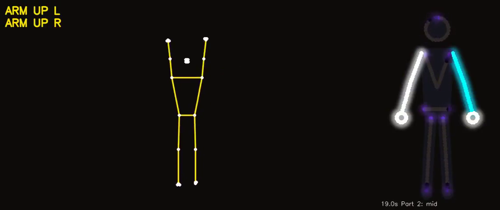

# PoseCue

**Film a dancer, get LED cues.** PoseCue watches a dance video, tracks the
dancer's body, listens to the music, and writes a light-show file for
[LumaCue](https://github.com/aswinsamuel-codes/LumaCue) LED dance costumes: when the dancer raises their
left arm, the LEDs on the left arm wipe on; when they jump, a band of light
rises up the whole costume; when they freeze, the costume goes dark except
for a slow breath on the chest.



*Left: the tracked dancer (here the built-in synthetic one). Right: the
simulated LED costume running the generated cues, rendered with the same
rules as LumaCue Show Studio's digital twin.*

## Why

Programming lights for a dance crew by hand means scrubbing through the song
and placing every cue on a timeline. The choreography already says where the
accents are: a punch, a jump, both arms up on the drop. PoseCue reads those
moments from a rehearsal video and turns them into a first draft of the light
show, on the music's beat grid, that the light engineer then edits in Show
Studio like any other show.

It is built for one real use: a 10-dancer LED show. Film one dancer doing the
routine, and every costume gets cues that follow the choreography.

## What it detects

| Move | How | Light cue (on the zones that moved) |
|---|---|---|
| Arm raise | wrist clearly above its shoulder, per side | wipe along that arm and hand band, hold while it's up |
| Jump | hips and both ankles leave their usual height together | a band of light rises up the body (`rise`) |
| Spin | shoulders swap sides twice in ≤ 2.5 s | a band sweeps across the body (`sweep`; `rainbow` when energetic) |
| Hit | a limb moves fast then stops sharply (punch, pop, kick) | 150 ms accent flash on that limb |
| Stillness | body barely moves for > 1.2 s | everything dark except a slow chest breath |
| Energy | overall body speed, 0–1 | raises or lowers each music section's base look |

From the music (a NumPy port of Show Studio's own analysis, so the beat grid
matches): tempo, beats, bars, low/mid/high sections, drops and strong hits.
Move cues within 120 ms of a beat snap onto it.

## Architecture

```
dance.mp4 ──► pose.py ──────► PoseSequence (33 landmarks × frames)
              MediaPipe Pose Landmarker, VIDEO mode, 480 px, every 2nd frame
                                   │
                                   ▼
                              moves.py  (pure functions, measured in torso lengths)
                                   │  arm raises, jumps, spins, hits, stillness, energy
song.mp3 ──► audio.py ──► beats, bars, sections, drops       │
              (port of LumaCue analyze.ts)    │               │
                                              ▼               ▼
                                         cues.py: base layer per 4-bar phrase
                                                  + move layer on body-part zones
                                                       │
                              zones.py: body part → costume zone (split / full / bench)
                                                       │
                                                       ▼
                         export.py ──► show.lumacue.json (LumaCue ShowProject + costume)
                         preview.py ─► preview.mp4 (video | simulated costume, with the song)
```

| Module | Role |
|---|---|
| `posecue/pose.py` | MediaPipe Tasks `PoseLandmarker` wrapper. The only module that imports MediaPipe. |
| `posecue/landmarks.py` | `PoseSequence`, landmark indices, gap filling, smoothing, `.npz` cache (no pickles). |
| `posecue/moves.py` | Move detection: pure functions on landmark arrays. |
| `posecue/audio.py` | Audio decoding (ffmpeg) and beat/section analysis. |
| `posecue/cues.py` | Turns music + moves into LumaCue clips. |
| `posecue/zones.py` | Costume definitions and the body-part → zone map. |
| `posecue/render.py` | Python port of Show Studio's LED renderer, for the preview and tests. |
| `posecue/export.py` | Show-file builder and a strict validator mirroring LumaCue's `parseShowProject`. |
| `posecue/preview.py` | Side-by-side preview video. |
| `posecue/synth.py` | Synthetic dancer and drum track for tests and `--demo`. |
| `posecue/safety.py` | Input/output file checks and size limits. |

## Quick start

Needs Python 3.10+ and a normal laptop CPU (no GPU). Tested on Windows with
Python 3.11, 8 GB RAM.

```bash
git clone https://github.com/aswinsamuel-codes/PoseCue-.git
cd PoseCue-
python -m pip install -r requirements.txt

# Try it with no video and no model: a built-in synthetic dancer and beat
python -m posecue --demo -o demo.lumacue.json --preview demo.mp4

# Real video: download the pose model once (~5.5 MB, Apache 2.0, from Google)
python scripts/download_models.py
python -m posecue dance.mp4 -o show.lumacue.json --preview preview.mp4
```

More options:

```bash
# separate song file that starts 1.2 s before the video, energetic fire colours,
# 10 dancers, cues on every costume, and keep the tracking for next time
python -m posecue dance.mp4 -o show.lumacue.json --audio song.mp3 --offset-ms 1200     --style energetic --palette fire --costume split --dancers 10 --track all     --save-pose dance.npz

# re-run with a different style without tracking again
python -m posecue --pose dance.npz --audio song.mp3 -o calm.lumacue.json --style calm
```

Run `python -m posecue --help` for everything (`--mirror` for selfie videos,
`--no-base` for move cues only, `--moves moves.json` to inspect what was
detected, `--max-width` / `--frame-step` / `--threads` for speed).

Speed: tracking is the slow part, so PoseCue shrinks frames to 480 px and
analyses every 2nd frame by default. Use `--save-pose` once, then `--pose`
to try other styles in seconds. (The synthetic demo, including its preview,
runs in about 10 s on a CPU laptop.)

## Using the result in LumaCue Show Studio

The output is a normal LumaCue show file, the same format Show Studio writes
with **Save show**: the `ShowProject` (version 1: name, dancers, length,
clips, sections) plus the `costume` setup it was made for. Open it in Show
Studio with **Open show**. Every cue is an ordinary clip you can move, recolour
or delete; the music sections appear as named sections ("Part 3: high (drop)").
Load the song in Show Studio as usual: the file stores only its name.

Costumes (`--costume`):

- **split** (default): LumaCue's *Full suit* (hand bands, arms, chest V,
  legs, hood, belt) with the arms and legs as separate left and right strips,
  so a left-arm raise lights only the left arm. Zone ids `a`–`f` keep the Full
  suit's meaning (`b`, `d` become the **left** arm and leg), plus `g` right arm
  and `h` right leg. The split strips are LumaCue "drawn" zones on the same
  lines as the preset arms and legs.
- **full**: LumaCue's *Full suit* template exactly; left and right moves both
  drive the one arms zone.
- **bench**: LumaCue's 3-zone bench costume (arms, chest, legs), for the
  Arduino Nano bench rig.

"Left" always means the dancer's own left. In LumaCue's figure (drawn as the
audience sees the dancer) that is on the right-hand side.

The test suite checks the export against LumaCue's own `model.ts` and
`body.ts` when a LumaCue checkout sits next to this repo (or `LUMACUE_DIR`
points at one): same clip and section keys, effect ids, placements and preset
LED lines.

## Limitations

- **Early stage: not yet validated on real dance footage.** The detectors are
  tested on synthetic motion, and the full MediaPipe pipeline has been run on
  a rendered mannequin video (a 32 s clip tracks in about 10 s
  on a laptop CPU). Expect to tune `Tuning` thresholds on your own rehearsal
  videos; issues with `--moves` output attached are very welcome.
- **One dancer per video.** PoseCue tracks the most prominent person. For a
  crew, film one dancer (or each dancer separately and use `--track`).
- **Front-facing camera works best.** Spins are detected from the shoulders
  swapping sides; MediaPipe sometimes confuses a dancer's front and back.
  PoseCue repairs frames where every left/right label flips at once, but a
  dancer who stays facing away can still have their sides swapped. Very baggy costumes and dark stages lower
  tracking quality.
- **Thresholds are hand-set.** They are in torso lengths, so they don't
  depend on how big the dancer is in the frame, but they were tuned on
  synthetic motion and a few clips, not a labelled dataset. Fast styles
  (popping, krump) may produce more "hits" than you want; use `--style calm`
  or delete clips in Show Studio.
- **Audio offset is manual.** With `--audio`, the song must line up with the
  video, or you pass `--offset-ms`.
- **The pose model needs a separate download** (Google's MediaPipe
  Pose Landmarker, Apache 2.0); it is not bundled.
- MediaPipe's Python Tasks API has no thread setting; PoseCue limits OpenCV
  and BLAS threads to `--threads`, but MediaPipe may use a few more.

## Roadmap

- Auto-align a separate song with the video's own soundtrack (cross-correlation).
- Multiple dancers in one shot → one track per dancer.
- More moves: kicks, floor work, arm waves (sweep along the arm), formations.
- A small labelled set of real dance clips to tune and test thresholds.
- Import straight into an open Show Studio session (no file step).

## Tests

```bash
python -m pytest
```

Tests use synthetic landmark sequences and synthetic drum tracks, so they run
without the pose model or any video: beat and section detection, every move
detector, left/right zone mapping, layering against the base layer, the LED
renderer, file-safety checks, the CLI, and the show-file schema against
LumaCue's source.

## Security

- No network access except `scripts/download_models.py`, which only fetches
  from Google's MediaPipe model storage over HTTPS with a size cap.
- Inputs must be existing local files of an expected type and size: URLs and
  ffmpeg protocols (`http:`, `pipe:`, `concat:`) and Windows device names are
  refused, ffmpeg is run without a shell and with `-protocol_whitelist file`.
- Outputs need an expected extension, never overwrite an input, need
  `--force` to replace an existing file, and are written atomically.
- Pose caches are loaded with `allow_pickle=False`.
- Video and audio decoding is done by OpenCV and FFmpeg: keep them updated,
  and don't run PoseCue on files from people you don't trust.

## License

MIT, see [LICENSE](LICENSE). MediaPipe and its models are © Google, Apache 2.0.
